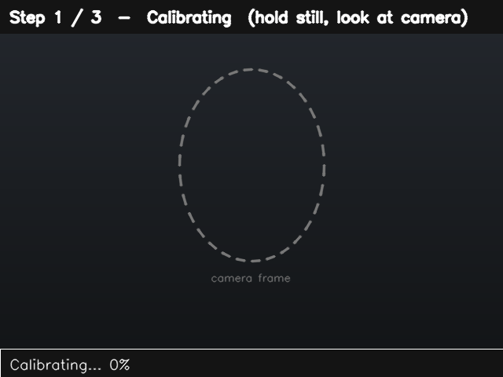
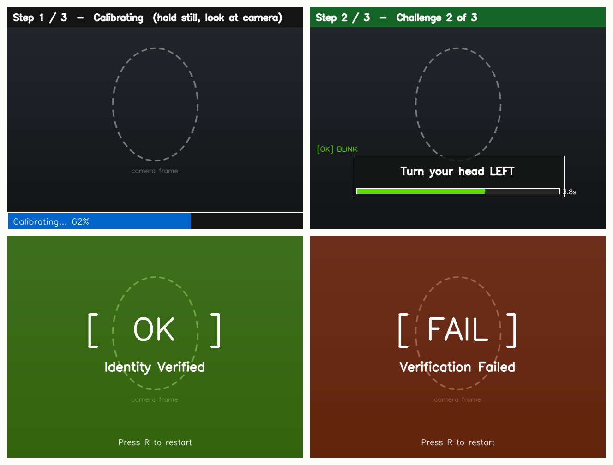
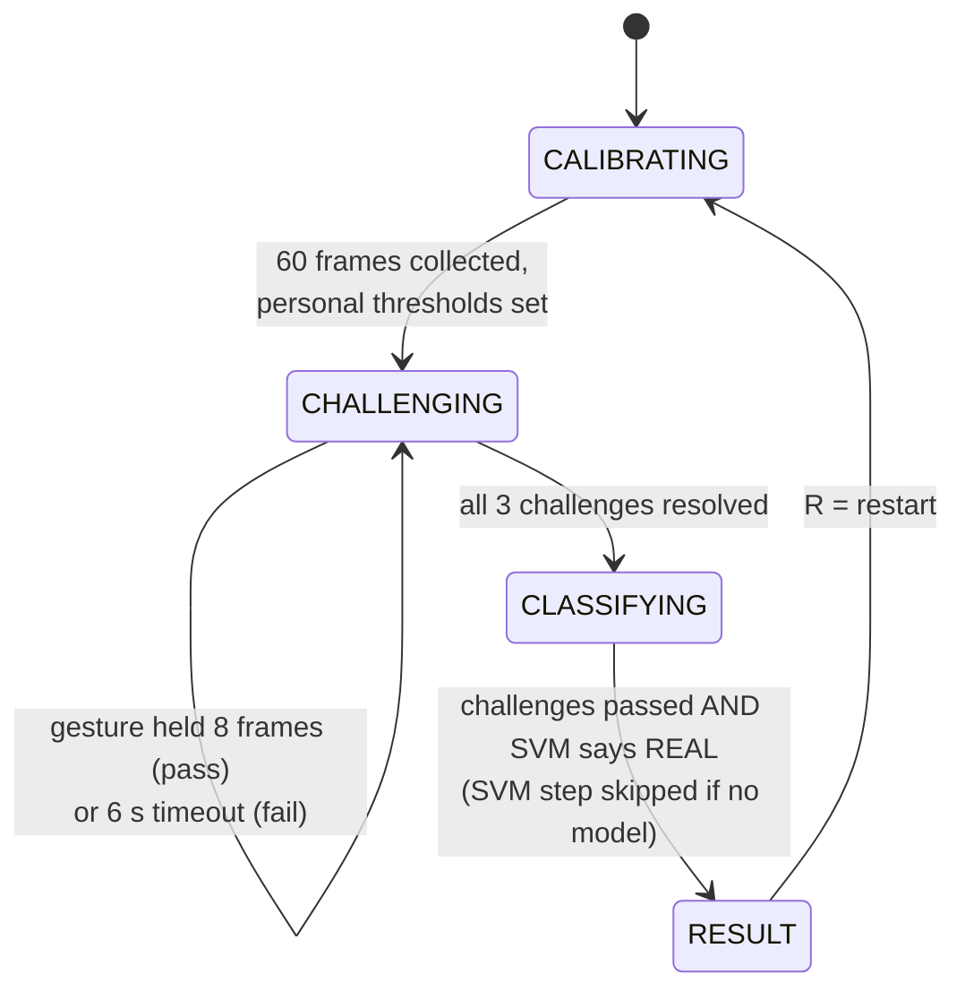

# Face Liveness Detection

**A real-time check that the face in front of the webcam is a live person, not a photo or a replayed video. It asks for random gestures and verifies each one from MediaPipe face landmarks.**



<sub>The frames above are drawn by the app's own `ui.py` on a placeholder background with a dashed face guide, so no camera and no real face. On a live run, the same overlays sit on your webcam feed, with dots on the tracked eye and mouth landmarks.</sub>

## What it does

A printed photo can't blink when asked. A pre-recorded clip doesn't know which gesture you'll ask for next. The app uses both facts:

1. **Calibrate.** For 60 frames (about 2 s) it measures *your* neutral face: eye openness, mouth openness and head pose.
2. **Challenge.** It picks **3 different gestures at random** from six: *blink*, *turn left*, *turn right*, *look up*, *look down*, *open mouth*. You get 6 seconds for each.
3. **Classify (optional).** While you respond, an SVM trained on your own real and spoof recordings scores a rolling window of landmark features as REAL or SPOOF.
4. **Verdict.** It shows **VERIFIED** only if every challenge passed and, when a model is loaded, the SVM also says REAL. Press **R** to retry or **Q** to quit.

It runs on CPU with an ordinary webcam. No depth sensor or GPU is needed.



## How it works



**Landmarks.** MediaPipe Face Mesh tracks 468 facial landmarks (478 with refined iris points) on every frame. Everything else is geometry on a handful of them:

| Signal | Formula | Used for |
|---|---|---|
| Eye aspect ratio (EAR) | eyelid gap ÷ eye width, per eye | blink |
| Mouth aspect ratio (MAR) | lip gap ÷ mouth width | open mouth |
| Head pose | nose-tip offset from the face centre, divided by face width (horizontal) or face height (vertical) | turn left/right, look up/down |

**Per-user thresholds.** Calibration averages your neutral EAR and MAR, then sets:
- blink threshold = 0.75 × your baseline EAR
- mouth threshold = 1.60 × your baseline MAR

A fixed cut-off such as "EAR < 0.25" fails people with narrow eyes or glasses, and unusual camera angles; ratios against your own baseline don't. Head turns trigger at a pose ratio of ±0.15 and nods at ±0.12.

**Anti-cheat rules** in [`challenge_engine.py`](challenge_engine.py):
- **Random order, no repeats.** Three of six gestures gives 120 possible sequences.
- **Hold for 8 consecutive frames.** A one-frame glitch can't pass a challenge.
- **Both eyes must close for a blink**, so a wink doesn't count.
- **Wall-clock timeout.** Hiding your face doesn't pause the 6-second timer.

**Optional SVM.** Each frame becomes a 10-number feature vector:
- left, right and average EAR
- MAR
- the two head-pose ratios
- three open/closed flags (left eye, right eye, mouth)
- face width relative to the frame

[`classifier.py`](classifier.py) averages the last 15 vectors and runs an RBF-kernel SVM (C = 10) with a `StandardScaler`. [`data_collector.py`](data_collector.py) records labelled samples from your webcam, and [`train_model.py`](train_model.py) trains the SVM on a stratified 80/20 split and saves it. Without a model, the app falls back to the challenges alone instead of crashing.

| File | Role |
|---|---|
| [`main.py`](main.py) | Webcam loop and the state machine |
| [`config.py`](config.py) | Every threshold, timing, landmark index and colour; no magic numbers elsewhere |
| [`landmark_utils.py`](landmark_utils.py) | EAR, MAR, head-pose and feature-vector math (pure functions) |
| [`calibration.py`](calibration.py) | Baseline measurement and personal thresholds |
| [`challenge_engine.py`](challenge_engine.py) | Random challenge selection and per-frame verification |
| [`classifier.py`](classifier.py) | Rolling-buffer SVM wrapper |
| [`ui.py`](ui.py) | All OpenCV drawing, no application logic |
| [`data_collector.py`](data_collector.py) · [`train_model.py`](train_model.py) | Collect samples and train the SVM |

## Results

There are no benchmark numbers yet. The challenge-response layer needs no training data. The SVM is trained on whatever real and spoof samples you record, so its accuracy is specific to your camera, lighting and attack media. `train_model.py` prints accuracy, precision, recall, F1 and a confusion matrix for your own data.

What has been checked: all modules import and run with the pinned dependencies (MediaPipe 0.10.21, OpenCV 4.11, scikit-learn 1.9, Python 3.12), and the collect → train → load → predict path works end to end.

**Limits, stated plainly:**
- It stops printed photos and pre-recorded clips. It doesn't stop a live deepfake or a 3D mask driven by the attacker's own movements.
- Head pose is a 2D approximation from landmark offsets, not a full PnP pose estimate.
- Frame-count rules assume about 30 fps. A slow camera makes the 8-frame hold take longer.
- A blink has to be a deliberate eye close of about 8 frames, roughly 0.3 s, not a natural flicker.
- It hasn't been measured against a public anti-spoofing benchmark such as CASIA-FASD or OULU-NPU.

A server-side version of the same idea is part of [Attendify](https://attendify.pro).

## Run it

Use Python 3.9–3.12 with a webcam.

```bash
git clone https://github.com/shakaibarsalan/face-liveness-detection.git
cd face-liveness-detection
python -m venv .venv
# Windows: .venv\Scripts\activate    macOS/Linux: source .venv/bin/activate
pip install -r requirements.txt
python main.py
```

MediaPipe is pinned to `0.10.21` on purpose. Newer releases no longer ship the `mp.solutions.face_mesh` API this project uses.

**Add the SVM layer (optional):**

```bash
python data_collector.py --label real    # move naturally, blink, turn; press S to save, Q to quit
python data_collector.py --label spoof   # hold up a printed photo or a phone video; S to save
python train_model.py                    # prints metrics, saves models/spoof_classifier.pkl
python main.py                           # a REAL / SPOOF badge now appears top-right
```

Aim for at least 150 samples per class. The collected CSVs and the trained model stay on your machine: `data/` and `models/` are git-ignored, because they are derived from face data.

**Tuning.** Every knob is in [`config.py`](config.py):
- `CHALLENGE_COUNT` and `CHALLENGE_TIMEOUT` set how many challenges you get and how long each lasts.
- `EAR_BLINK_RATIO` and `MAR_OPEN_RATIO` set blink and mouth sensitivity.
- `HEAD_TURN_THRESHOLD` and `HEAD_NOD_THRESHOLD` set how far you must turn or nod.
- `BUFFER_SIZE` sets the SVM window.

## Tech stack

Python · OpenCV · MediaPipe Face Mesh · NumPy · scikit-learn (SVM, StandardScaler) · joblib

It was built for the Computer Vision course in the BS Computer Science programme at the University of Management and Technology (UMT), Lahore.

## License

[MIT](LICENSE)

## Author

**Muhammad Shakaib Arsalan**: [shakaib.vercel.app](https://shakaib.vercel.app) · [LinkedIn](https://www.linkedin.com/in/shakaib-arsalan)
